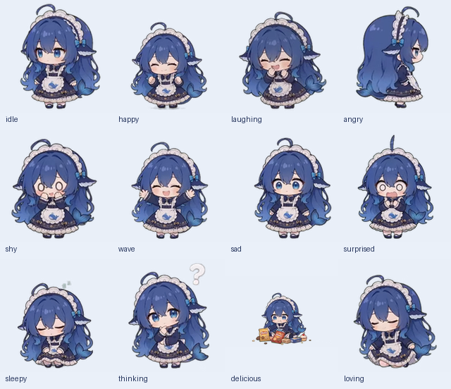

# DSH 娘动态屏幕与串口扩展使用手册

适用硬件：立创·实战派 ESP32-S3，320×240 横屏，16MB Flash。
本版本将原来的简化静态头像替换成 dsh-pet 的蓝毛小女仆原版全身动画。

当前版本采用 Rust 模块化动画运行逻辑、30Hz 时间轴和 DSA1 差分资源。
构建方式、模块划分与 VS Code ESP-IDF 插件配置见 [30 帧动画手册](ANIMATION.md)。

新增板载陀螺仪体感互动：四元数与误差状态卡尔曼融合、倾斜侧身、摇晃惊讶、
倒置生气、静放打瞌睡与拿动唤醒。详见[体感互动手册](MOTION.md)。

## 屏幕效果

保留蓝色渐变长发、女仆头饰、蝴蝶结、鲸鱼围裙和尾巴。待机时自动呼吸、眨眼，
收到云端情绪后切换对应动画。每个动作循环播放，直到下一次情绪切换。




- 待机：`neutral`、`relaxed`、开机占位 `robot_2` → 呼吸休闲。
- 开心：`happy` → 开心跃动；`laughing`、`funny`、`silly` → 挠痒咯咯笑。
- 招呼：`cool`、`confident`、`winking` → 元气挥手。
- 生气：`angry` → 傲娇转身；惊讶：`surprised`、`shocked` → 被吓一跳。
- 害羞：`embarrassed` → 害羞惊讶。
- 低落：`sad`、`crying` → 垂头叹气冒汗（原资源没有单独的流泪动作）。
- 困倦：`sleepy` → 小憩沉眠。
- 思考：`thinking`、`confused` → 思考冒泡。
- 美味：`delicious` → 大口吃零食。
- 喜爱：`loving`、`kissy` → 女仆屈膝礼仪。

这 22 个名称映射到 12 段原动画。它们由现有情绪接口触发，不是语音音量驱动的嘴型同步。
没有收到其他情绪时持续播放待机动画。动作间的风格、姿势来自原版素材。

## 资源与实现

- `main/assets/dsh-girl/*.dsa`：固件使用的透明差分动画，160×160，30 帧/秒时间轴，32 色。
- `scripts/dsh_pet/build.py`：可重复执行的转换工具，注释说明了透明通道、裁切、调色板和帧时长。
- `scripts/dsh_pet/sources/`：选用的 12 个 WebM 原片以及原项目 MIT 许可。
- `scripts/build_default_assets.py`：按内容 SHA-256 去重，让情绪别名共用动画文件。
- `main/CMakeLists.txt`：仅本板默认使用这套资源，并追踪资源文件变化。
- `main/boards/lckfb/szpi-esp32s3/features/animation/rust/`：Rust 帧时钟、格式校验、差分还原和体感平滑。
- `dsh_animation_player` 与 `dsh_pet_display`：本板的解压、屏幕播放和情绪适配模块。

转换时强制使用 FFmpeg 的 `libvpx-vp9` 解码器保留 WebM 的 alpha 通道。
每段动画先求所有帧的可见区域并集，再固定裁切，避免逐帧缩放造成抖动或裁掉手脚。
共用调色板减少闪色，透明索引固定为 31；DSA1 对索引差分压缩，可清除旧轮廓。
Rust 使用绝对帧时间，按 33/34ms 安排帧，保持原动作时长并持续循环。
文档预览仍采用 GIF，固件播放与预览格式不同。原片多为 24fps，30Hz 时间轴包含重复帧。

最终默认资源包为 **8,249,051 字节**，8MB 分区还剩 **139,557 字节**。
索引、差分与三个原生 RGB565A8 帧缓冲共 `160×160×2 + 176×176×3×3 = 329,984` 字节，
另有解压器、任务栈和 LVGL 等开销。Rust 直接生成约 176 像素的角色画面。
修改分辨率、帧率或增加动作后必须重新检查分区上限。

原始角色与动画来自 **[PC2005-cloud/dsh-pet](https://github.com/PC2005-cloud/dsh-pet)**，
原作者 PC2005-cloud。作者署名与 MIT 许可保存在 `sources/LICENSE`
和 `main/assets/dsh-girl/LICENSE.dsh-pet`。完整来源见 [第三方声明](../../THIRD_PARTY_NOTICES.md)。

## 修改形象或动作

在工程根目录运行；Python 需要 Pillow，FFmpeg 需要支持 libvpx-vp9：

```powershell
python scripts/dsh_pet/build.py --ffmpeg "你的 ffmpeg.exe 路径"
```

源码已经随 Git 保存，无需安装 dsh-pet。要重新导入原素材：

```powershell
python scripts/dsh_pet/build.py --ffmpeg "你的 ffmpeg.exe 路径" --import-from "你的 dsh-pet 包目录"
```

`ACTIONS` 定义原片，`EMOTIONS` 定义情绪别名，`SIZE/FPS/COLORS` 控制资源规格。
工具输出 DSA1、动作清单 `scripts/dsh_pet/pet-animations.json` 和 GIF/静态预览图。
替换动作后同步更新本手册中的预览图片。不要重新运行旧的静态头像生成器覆盖动画目录。

## 编译与烧录

先按[安装手册](SETUP.md)准备 ESP-IDF v6.1 和 esp Rust 工具链，
在已激活环境的终端中进入仓库目录。下面的 COM3 替换为实际串口：

```powershell
idf.py build
idf.py -p COM3 flash
idf.py -p COM3 monitor
```

端口以实际连接为准。必须同时烧录应用和 `generated_assets.bin`，只烧录应用不会更新形象。
`flash` 默认使用当前工程的烧录清单。无需擦除 NVS，Wi-Fi 和激活信息可保留。
串口监视器按 Ctrl+] 退出；烧录前关闭占用同一端口的软件。

全新配置可用官方构建入口（会更新本地 sdkconfig）：

```powershell
python scripts/build.py lckfb/szpi-esp32s3 --name lichuang-dev --language zh-CN
```

本地配置选择 `BOARD_TYPE_LICHUANG_DEV_S3`、ESP32-S3、16MB Flash、
`partitions/v2/16m.csv`、中文、设备端 AEC、`wn9_nihaoxiaozhi_tts` 唤醒模型。
构建输出目录是 `build/`，不手工编辑生成文件。

## 已有串口扩展

本版本一并保存已有的 UART1 扩展代码，位于
`main/boards/lckfb/szpi-esp32s3/features/expansion_uart/expansion_uart.{h,cc}`。
默认 TX=GPIO10、RX=GPIO11、115200 波特率，接收缓冲保留最近 4096 字节。
实际接线仍需对照板子接口丝印或原理图确认；本次动画修改不代表完成外部设备收发联调。

可在 menuconfig 的 Expansion UART 菜单调整参数，或使用以下语音侧 MCP 工具：

- `self.expansion_uart.write`：发送文本，或 `hex:AA5501` 形式的二进制。
- `self.expansion_uart.read`：读取接收缓冲，可设置等待时间。
- `self.expansion_uart.status`：查看引脚、波特率、累计收发量。
- `self.expansion_uart.configure`：修改引脚或波特率，写入 NVS，下次启动沿用。

## 验证与故障定位

主机侧检查覆盖全部 22 个 DSA1 名称的尺寸、30Hz 时间轴、透明角点以及实际帧变化，
资源打包测试验证情绪名称未丢失且相同动画只保存一份。

```powershell
python -m unittest discover -s scripts/tests -p test_build_default_assets.py -v
python -m unittest discover -s scripts/tests -p test_dsh_animation.py -v
```

完整测试建议设置 `PYTHONUTF8=1`，Windows 默认 GBK 会导致部分含中文文件的测试失败。
某些测试还需要 Unix shell 或主机 C++ 编译器；固件编译使用 ESP-IDF 自带工具链。
烧录后的启动记录和最终验证结果见 `VALIDATION.md`。

- 仍是旧头像：检查 assets 分区是否一起烧录，以及打包日志中的资源路径。
- 不动：检查是否出现 `Rust DSA1 ready`，以及 `Invalid DSA1 frame` 解码错误日志。
- 黑底或拖影：保留 libvpx-vp9、透明索引和差分清零设置，勿换成丢失 alpha 的解码器。
- 分区超限：优先减少动作或帧率，保持 `--max_size 0x800000` 校验；不要绕过校验。

## Git 版本

应用、动画资源、转换工具、原始素材、许可和本手册都在同一个提交中保存。
首次公开版本标签为 `v0.1.0`。检出后可按上面的步骤重建与烧录。
Wi-Fi 凭据与设备激活信息存储在板上，不纳入仓库。

验证记录中出现的旧开发标签只用于说明本地测试阶段，未上传到公开仓库。

本版本同时按功能整理目录，并关闭远程固件 OTA。云端激活与 USB 烧录保留；
功能入口见 [模块目录说明](../../main/boards/lckfb/szpi-esp32s3/features/README.md)，
关闭策略见 [OTA 模块说明](../../main/ota/README.md)。
